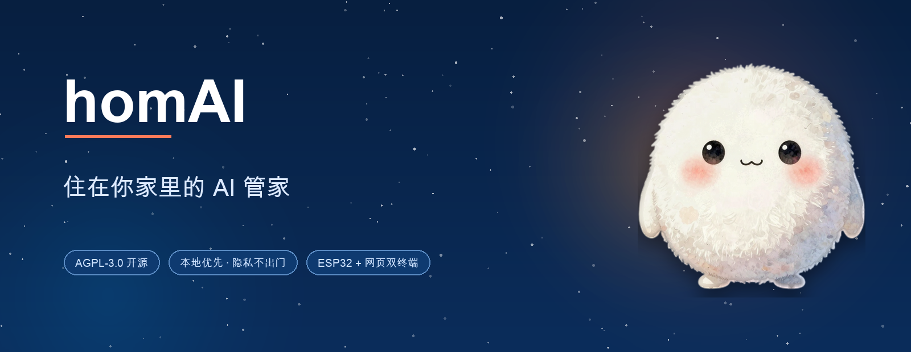
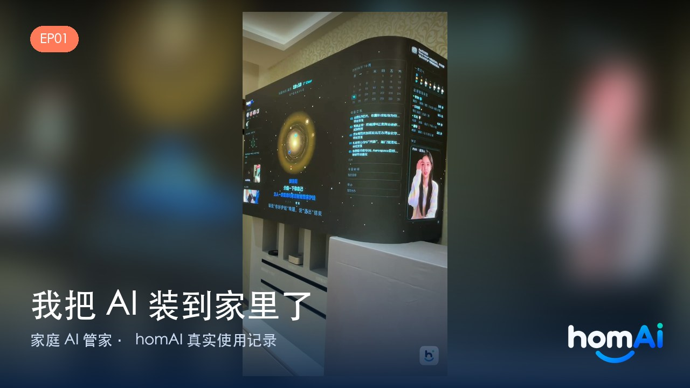
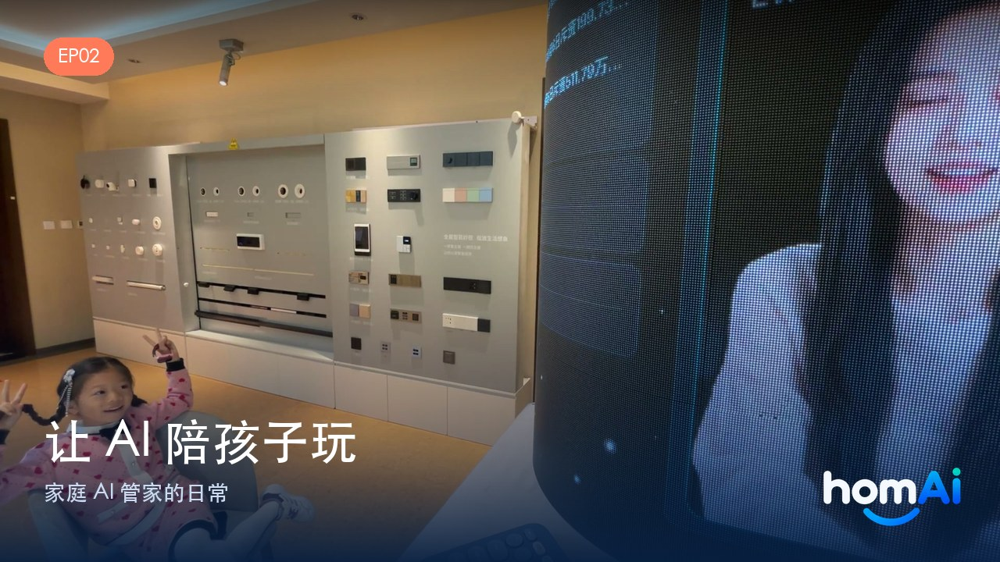
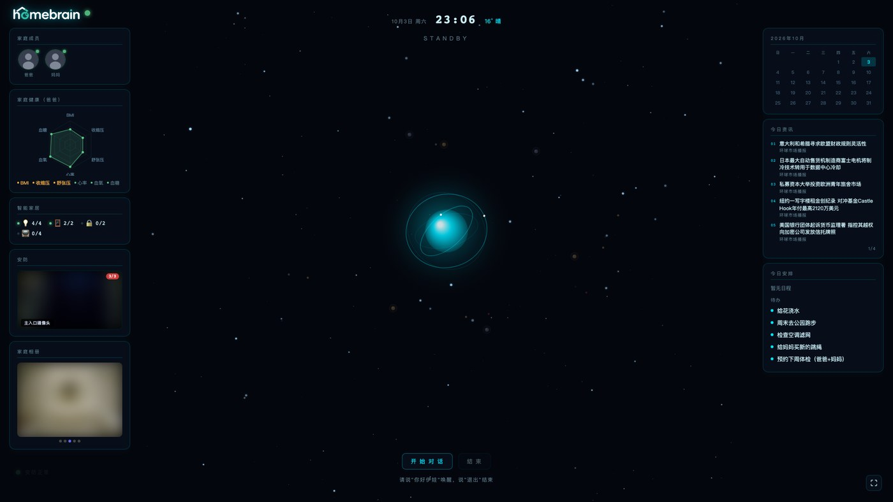
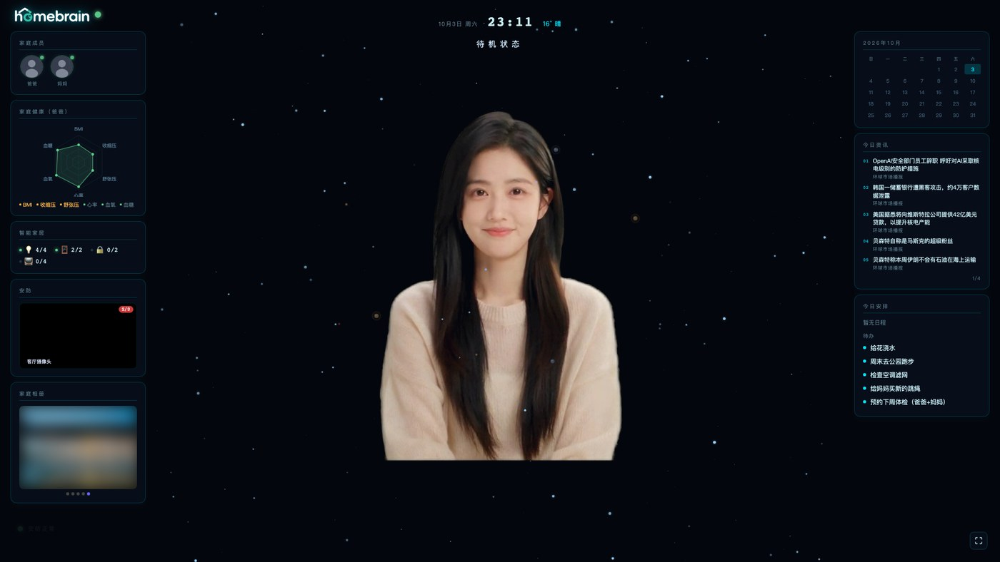
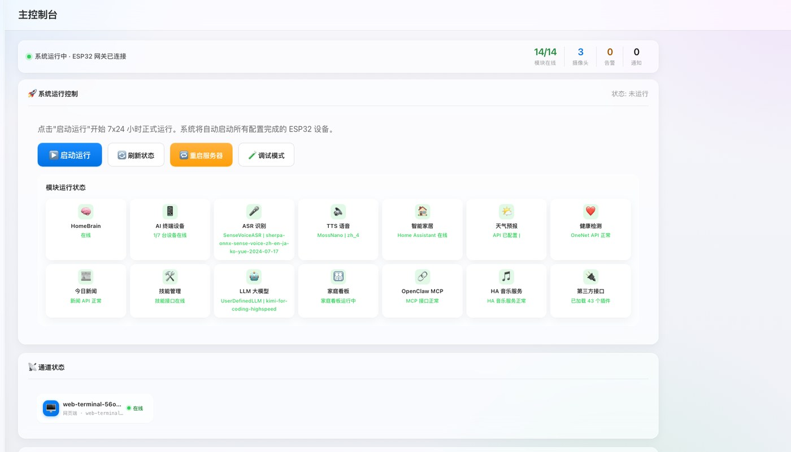
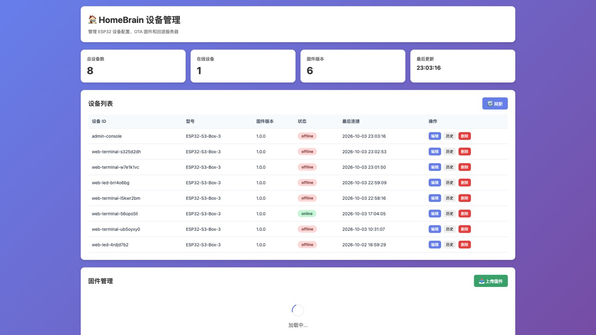
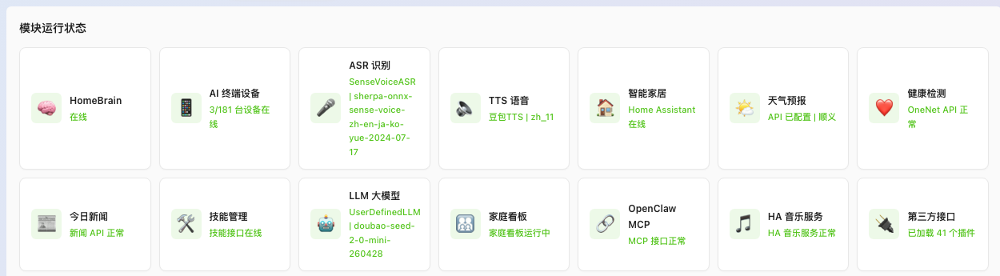

<p align="center"><a href="README.md">中文</a> · <b>English</b></p>

<p align="center">
  
</p>

<p align="center">
  <a href="https://myhomai.com"></a>
  
  
  
</p>

<p align="center"><b>🌐 <a href="https://myhomai.com">Visit our site</a> · 📺 <a href="#-videos">Watch the videos</a> · 💬 <a href="https://myhomai.com/#join">Join the beta</a></b></p>

---

**homAI** is a **home AI butler system** — not a phone assistant, but a "Jarvis" that actually lives in your house:

- 🎙 **Listens**: ESP32 voice devices + a web voice terminal — two ways in, talk anytime
- 🧠 **Understands**: rooms, lights, sensors, family members and schedules — it truly knows your home
- 📝 **Remembers**: long-term family memory that keeps everyone's preferences and important dates
- 🛠 **Acts**: 50+ skills — home control, music, reminders, health monitoring, messaging…
- 👧 **Has a face**: a digital-human butler on your screen, with customizable looks, voice and wake word

> 🔒 **Runs entirely on your own machine**: what you said, what it remembered, and your health data never leave your home.

---

## 📺 Videos

<p align="center">
  <a href="https://www.youtube.com/@homAI" target="_blank">
    
  </a>
  <a href="https://youtu.be/fkcnt8pYA0M" target="_blank">
    
  </a>
</p>

<p align="center">
  <b>EP01 · English version coming soon</b> &nbsp;·&nbsp; <b>EP02 · AI plays with the kids</b>
</p>

<p align="center">
  <a href="https://youtu.be/fkcnt8pYA0M">▶ YouTube EP02 (English promo)</a> ·
  <a href="https://youtube.com/shorts/RcdYNQkkpf4">▶ EP02 (alt cut)</a>
</p>

> 📢 Also on Douyin — search <b>homAI</b>.

---

## ✨ Interface Preview

### 🗣 Voice terminal · Planet mode

Just open a browser — works on a living-room TV or any computer.

<p align="center"></p>

### 👧 Voice terminal · Digital-human mode

A digital-human butler with lip sync, so conversations feel warm instead of robotic.

<p align="center"></p>

### 🖥 Home console

Devices, channels, plugins and configuration — all managed in one place.

<p align="center"></p>

### 📡 Device management (ESP32 / OTA)

ESP32 device onboarding, status monitoring and firmware OTA upgrades.

<p align="center"></p>

### 🧩 Module status

<p align="center"></p>

---

## 🎯 Core Capabilities

### 🎙 Voice Interaction

- **Two voice terminals**: web-based (open and go, with a digital-human avatar) and ESP32 hardware (living room / bedroom)
- Custom wake words ("Hey Eva", or any name you like), real-time interruption, natural multi-turn dialogue
- Voiceprint recognition — it knows who is talking and adapts accordingly
- Multiple voice styles and full voice settings management

### 🏠 Smart Home

- Deep Home Assistant integration: lights, HVAC, curtains, sensors…
- Batch device control, scene automation, real-time state queries
- Music: Apple Music / Music Assistant / any media player on demand
- Camera views, door monitoring, family album on a big screen

### 📝 Family Memory

- Long-term memory: preferences, habits and important events
- Conversation history stored locally in SQLite — nothing leaves the house
- Family profiles and role settings: every member gets their own "butler persona"

### ❤️ Health Guardian

- Track weight, heart rate, blood pressure, blood oxygen and glucose with trends
- Automatic alerts on anomalies, daily health briefings
- Medication reminders, check-up reminders, everyday health care
- Health hardware ecosystem: smart scales, oximeters, blood-pressure monitors【in progress】
- Deeper health analytics and hardware integration【commercial edition】

### 🏡 Everyday Errands

- Schedules, todos and reminders: cooking, medication, trips, anniversaries
- Family messaging via WeChat / Feishu / SMS / voice messages
- Mail triage, news briefings, weather, parcel tracking, restaurant booking, ride hailing…

### 👧 Digital-Human Butler — looks and voice, your call

The digital human isn't a fixed character — it's **fully customizable**:

- **Appearance**: build any character you want
- **Wake word**: "Hey Eva", "Hey Jarvis"? Multiple wake words and nicknames are fine
- **Voice**: pick from multiple voice styles so it sounds like someone you like
- Always on screen: lip sync and real-time dialogue
- Voice cloning and family member avatars【in progress】

> Make it your "Jarvis" — or make it part of the family.

### 🧰 More Skills

- Knowledge-base Q&A (RAGFlow), web search
- Mac control: launch apps, open pages, operate the screen
- Device management / firmware OTA
- Plugin architecture: continuously extensible, contributions welcome

> Items marked 【commercial edition】 are available in the commercial build; 【in progress】 are under active development.

---

## 🔌 Hardware & Ecosystem: ESP32 is a shared foundation

homAI's voice terminals run on **ESP32 series devices** (such as ESP32-S3):
place one in the living room, bedroom or on your desk, and it becomes your home's ears and mouth.

In 2026, Meta open-sourced **Muse Gadgets** — with an ESP32 you can build your own AI toys and smart accessories.
Same direction as ours: **give every household their own AI companion**.

- Already own an ESP32 device? Plug it into homAI and it becomes a home AI butler instantly
- Playing with Muse? You can connect a Muse toy to homAI as another chatty companion
- Microphone arrays, health devices — more hardware on the way

> ESP32 is just one entry point — the web voice terminal (and a future mobile app) can summon your butler too.

---

## 🧩 Architecture

Every stage of the conversation pipeline can run **locally or in the cloud** — combine them based on your compute and privacy needs:

```
🎙 Voice  →   ASR            →   LLM           →   TTS             →   🔊 Reply
              local / cloud       local / cloud       local / cloud
```

- **ASR (hear)**: local SenseVoice and friends, or cloud recognition — switch freely
- **LLM (think)**: local oMLX and others, or multi-vendor cloud models
- **TTS (speak)**: local MOSS, or cloud synthesis with multiple voice styles
- ESP32 devices connect over WebSocket (port 9800)
- Management API on HTTP 8003; plugin-based tool system (50+ tools)

> Fully local = dialogue keeps working offline. Only the heaviest model in the cloud = lightweight machines can run it too.

---

## 🚀 Quick Start

**Requirements**: macOS / Linux · Python 3.10+

```bash
git clone https://github.com/lewistouchtech/homAI.git && cd homAI
python3 -m venv venv && source venv/bin/activate
pip install -r requirements.txt

# create your own config (the template ships with every key left blank)
cp data/.config.yaml.example data/.config.yaml

bash restart.sh                  # start (logs: tmp/server.log)
curl http://localhost:8003/api/health
```

> API keys live in `data/.config.yaml` (never committed). Switch model / ASR / TTS there.

Then open in your browser:

| Page | URL |
| --- | --- |
| Home console | http://localhost:8003/console |
| Voice terminal | http://localhost:8003/terminal |

## ⚙️ Configuration (important)

- `config.yaml` is the main template; **`data/.config.yaml` overrides it** (written by the console)
- If your change doesn't take effect, trust the runtime API: `curl -s http://localhost:8003/api/config/providers`
- Restart after changing configuration: `bash restart.sh`
- `config.yaml`, `.env`, `data/`, `models/` contain secrets or large files and are not committed

---

## 📜 Licensing — Open Source + Commercial

This project is available under **dual licensing**:

| License | Terms | Who it's for |
| --- | --- | --- |
| **Community edition** | AGPL-3.0 | Individuals / families / research / commercial use that open-sources your changes |
| **Commercial edition** | Commercial license | Vendors / integrators / teams needing closed-source commercial use or white-label delivery |

### Community edition (AGPL-3.0)

| Use case | Free? |
| --- | --- |
| Personal / household use | ✅ Free |
| Learning, research, hacking | ✅ Free |
| Commercial use (complying with AGPL-3.0: publish your changes) | ✅ Free |
| Closed-source commercial use (integrating into a product, or running a commercial service without publishing source) | 💼 Commercial license required |

### Commercial edition (for smart-home vendors / integrators)

Multi-tenant management console, remote operations, bulk deployment and OTA, white-label (OEM) delivery,
advanced modules (health guardian, full memory, digital-human suite…), priority support.

- 📮 Commercial licensing / business: **lewis.li@msn.com**
- 🐛 Bug reports: GitHub Issues
- 🌐 Product info: <https://myhomai.com>

> Use it at home, have fun. Use it to make money without publishing your source? Let's talk.

**Trademark notice**: the "homAI" name, logo and avatar artwork are project assets and are not covered by the code license.

---

## 🗺 Roadmap

- ✅ **Shipped**: dual voice terminals (web / ESP32), digital-human butler, 50+ skills, health hardware ecosystem (scales / oximeters / blood-pressure monitors)
- 🔄 **In progress**: remote access (mobile)
- ☁️ **Planned**: optional cloud pack (remote access / health alerts / model gateway / cloud backup)
- 🎭 **Future**: voice cloning, family avatars, cloud-rendered digital humans, more commercial solutions

---

## 📌 Notes

- This repository is the **server core of homAI (community edition)**, running on macOS / Linux
- The commercial edition with full modules is delivered separately — see the licensing section above
- The repository baseline was frozen for stability on 2026-09-21 (dialogue interruption lifecycle, tool signatures, port hardening)
- GitHub history starts from that baseline; earlier history contained large model files and was not uploaded

## 📮 Contact

| Channel | Address |
| --- | --- |
| Website | <https://myhomai.com> |
| Business / commercial licensing | lewis.li@msn.com |
| Bug reports | [GitHub Issues](https://github.com/lewistouchtech/homAI/issues) |
| Contributing | [Contributing guide](CONTRIBUTING.md) · [Code of Conduct](.github/CODE_OF_CONDUCT.md) |
| Security issues | [Security policy](.github/SECURITY.md) (please don't open a public issue) |

## 🙏 Acknowledgements

homAI builds on many open-source projects, including:

- [xiaozhi-esp32-server](https://github.com/xinnan-tech/xiaozhi-esp32-server) (MIT) — the server architecture it started from
- [sherpa-onnx](https://github.com/k2-fsa/sherpa-onnx) (Apache-2.0) — offline speech recognition
- [FunASR](https://github.com/modelscope/FunASR) (MIT) — speech toolkit
- [MCP Python SDK](https://github.com/modelcontextprotocol/python-sdk) (MIT) — MCP support

**See [THIRD_PARTY_NOTICES.md](THIRD_PARTY_NOTICES.md) for the complete list of projects and licenses.**

> The "homAI" name, logo and avatar artwork are project assets; the code license (AGPL-3.0)
> does not grant trademark rights. The community edition includes the dialogue engine, voice
> pipeline, basic plugins, short-term memory and the MCP channel; long-term memory,
> health guardian, the full digital-human suite, device management, LED wall and cloud
> services are commercial features.
