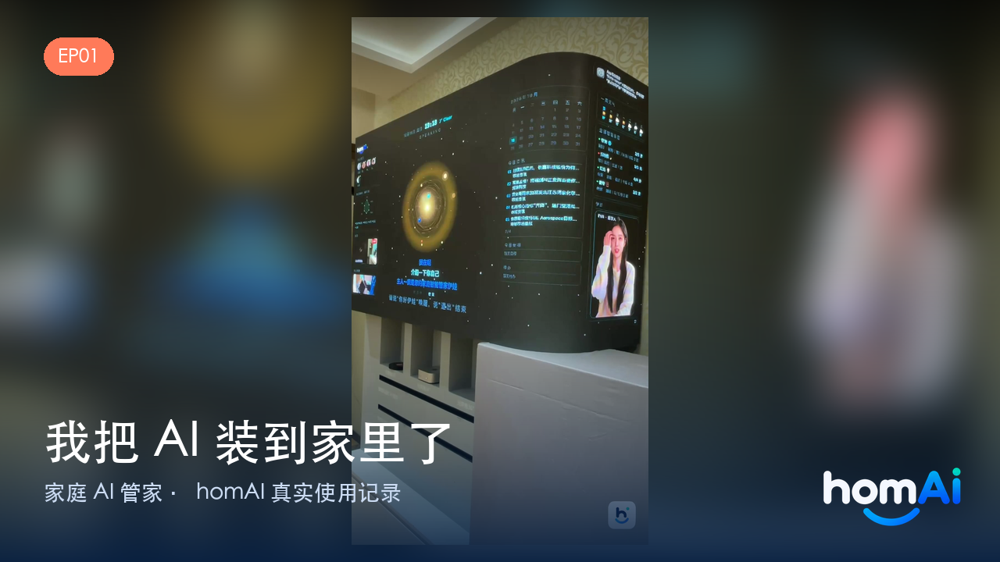
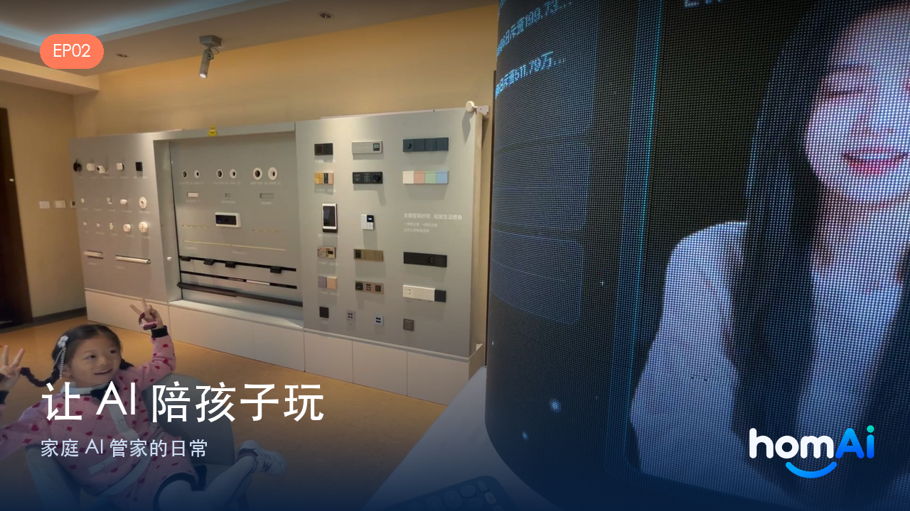

<p align="center"><b>中文</b> · <a href="README.en.md">English</a></p>

<p align="center">
  
</p>

<p align="center">
  <a href="https://myhomai.com"></a>
  
  
  
</p>

<p align="center"><b>🌐 <a href="https://myhomai.com">访问官网</a> · 📺 <a href="#视频">看视频</a> · 💬 <a href="#join">申请内测</a></b></p>

---

**homAI** 是一套**住在你家里的 AI 管家系统**——不是手机里的语音助手，而是一个真正待在这个家中的「贾维斯」：

- 🎙 **会听**：ESP32 语音设备 + 网页语音终端，两种入口，随时开口
- 🧠 **会懂**：接入房间、灯光、传感器、家人与日程，真正"懂这个家"
- 📝 **会记**：家庭长期记忆系统，记得住每个人的偏好与重要日子
- 🛠 **会做**：50+ 项技能——家居控制、音乐、提醒、健康监测、消息通知……
- 👧 **有形象**：数字人管家常驻屏幕，形象、声音、唤醒词随心定制

> 🔒 **可以完全跑在本地**：说了什么、记了什么、健康数据，全都在你自己手里。

---

## 📺 视频

<p align="center">
  <a href="https://youtube.com/shorts/N4M2LavMIhQ" target="_blank">
    
  </a>
  <a href="https://youtu.be/fkcnt8pYA0M" target="_blank">
    
  </a>
</p>

<p align="center">
  <b>EP01 · 我把 AI 装到家里了</b> &nbsp;·&nbsp; <b>EP02 · 让 AI 陪孩子玩</b>
</p>

<p align="center">
  <a href="https://youtube.com/shorts/N4M2LavMIhQ">▶ YouTube EP01</a> ·
  <a href="https://youtu.be/fkcnt8pYA0M">▶ YouTube EP02</a> ·
  <a href="https://youtube.com/shorts/RcdYNQkkpf4">▶ EP02 英文版</a> ·
  <a href="https://xhslink.cn/o/6URn4TVcKGv">▶ 小红书 EP01</a> ·
  <a href="https://xhslink.cn/o/7Br4KrSKoZm">▶ 小红书 EP02</a> ·
  <a href="https://weixin.qq.com/sph/AsGolp4j4T">▶ 视频号 EP01</a> ·
  <a href="https://weixin.qq.com/sph/ArtKbijwvd">▶ 视频号 EP02</a>
</p>

> 📢 抖音同步更新中，欢迎搜索 <b>homAI</b> 关注。

---

## ✨ 界面预览

### 🗣 语音终端 · 星球模式

浏览器打开即用，客厅大屏、书房电脑都能开。

<p align="center"></p>

### 👧 语音终端 · 数字人模式

数字人管家常驻屏幕——说话有口型，对话有温度。

<p align="center"></p>

### 🖥 家庭控制台

设备、通道、插件、配置，所有能力集中管理。

<p align="center"></p>

### 📡 设备管理（ESP32 / OTA）

ESP32 设备接入与状态监控，固件 OTA 在线升级。

<p align="center"></p>

### 🌌 LED 大屏待机画面

支持 LED 点阵大屏：待机时是水族馆，唤醒后是管家。

<p align="center"></p>

### 🧩 模块状态

<p align="center"></p>

---

## 🎯 核心能力

### 🎙 语音交互

- **两种语音终端**：网页端（浏览器即开即用，支持数字人形象）与 ESP32 硬件端（客厅 / 卧室常驻）
- 自定义唤醒词（「你好伊娃」，或任何你喜欢的名字）、实时打断、多轮自然对话
- 声纹识别：认得出家里每个人，对话"对人对味"
- 多角色音色、语音设置管理

### 🏠 智能家居

- Home Assistant 深度集成：灯光、空调、窗帘、传感器……
- 批量设备控制、场景联动、状态实时查询
- 音乐系统：Apple Music / Music Assistant / 媒体播放器随心点播
- 摄像头查看、门口画面、相册大屏展示

### 📝 家庭记忆

- 长期记忆（OpenViking）：记得住家人的偏好、习惯、重要事件
- 对话历史本地存储（SQLite），隐私不外流
- 家庭档案与角色设定：每个成员都有自己的"管家印象"

### ❤️ 健康守护

- 健康指标监测：体重、心率、血压、血氧、血糖等数据记录与趋势跟踪
- 异常自动告警、健康日报推送
- 用药提醒、体检提醒、日常健康关怀
- 健康硬件生态：体脂秤、血氧仪、血压计等设备对接【正在优化】
- 更完整的健康分析与硬件深度集成【商业版扩展】

### 🏡 家庭事务

- 日程、待办、提醒：做饭、吃药、出行、纪念日一个不落
- 家庭消息：微信 / 飞书 / 短信 / 语音留言多通道通知
- 邮件整理、新闻播报、天气查询、快递查询、餐厅预订、叫车助手……

### 👧 数字人管家——形象和声音，都由你定义

数字人不是固定的形象，而是**完全可定制**的：

- **形象自定义**：支持定制任意角色形象
- **唤醒词自定义**：叫「你好伊娃」，还是叫「你好贾维斯」？多个唤醒词、专属昵称都行
- **声音自定义**：多音色自由搭配，让管家用你最喜欢的声音说话
- 常驻屏幕：口型同步、实时对话；LED 大屏联动（水族馆待机、唤醒自动接管）
- 更进阶的专属声音克隆、家人形象定制【正在优化】

> 把它做成你的「贾维斯」，或者做成家里的一份子——让 AI 管家真正属于你的家。

### 🧰 更多技能

- 知识库问答（RAGFlow）、联网搜索
- Mac 控制：App 启动、网页打开、屏幕操作
- 设备管理 / OTA 固件升级
- 插件化架构：能力可持续扩展，欢迎共建

> 标注【商业版扩展】为商业版本能力，【正在优化】为开发中能力。

---

## 🔌 硬件与生态：ESP32 是共同底座

homAI 的语音终端运行在 **ESP32 系列设备**上（如 ESP32-S3 等）：
放在客厅、卧室、书桌，它就是家里的"耳朵和嘴巴"。

2026 年，Meta 开源了 **Muse Gadgets**——用 ESP32 就能打造自己的 AI 玩偶与智能配件。
方向和我们一致：**让每个家庭都有属于自己的 AI 伙伴**。

- 已有 ESP32 设备？接入 homAI，它立刻变成家里的 AI 语音管家
- 想玩 Muse？也可以把 Muse 玩偶接入 homAI，让家里多一个能聊天的伙伴
- 麦克风阵列、LED 大屏、健康设备……更多硬件持续接入中

> ESP32 只是入口之一——网页语音终端（以及未来的手机端）同样能召唤你的管家。

---

## 🧩 技术架构

对话链路每一环**可本地、可云端**，按算力与隐私需要自由组合：

```
🎙 声音  →   ASR 语音识别   →   LLM 大模型   →   TTS 语音合成   →   🔊 回答
              本地 / 云端        本地 / 云端        本地 / 云端
```

- **ASR（听）**：本地 SenseVoice 等 / 云端识别服务，自由切换
- **LLM（想）**：本地 oMLX 等 / 云端多厂商大模型
- **TTS（说）**：本地 MOSS 等 / 云端合成、多音色
- ESP32 设备通过 WebSocket（端口 9800）接入服务端
- 管理接口 HTTP 8003；插件化工具系统（50+ 工具）

> 全本地组合 = 断网也能对话；只把最重的模型放云端 = 轻量设备也能跑。

---

## 🚀 快速开始

**环境要求**：macOS / Linux · Python 3.10+

```bash
git clone https://github.com/lewistouchtech/homAI.git && cd homAI
python3 -m venv venv && source venv/bin/activate
pip install -r requirements.txt
bash restart.sh                  # 启动（日志：tmp/server.log）
curl http://localhost:8003/api/health
```

启动后浏览器访问：

| 页面 | 地址 |
| --- | --- |
| 家庭控制台 | http://localhost:8003/console |
| 语音终端 | http://localhost:8003/terminal |
| LED 大屏 | http://localhost:8003/led |

## ⚙️ 配置（重要）

- `config.yaml` 是主配置模板；**`data/.config.yaml` 会覆盖它**（后台保存时写入）
- 改了不生效时，以运行时接口为准：`curl -s http://localhost:8003/api/config/providers`
- 修改配置后重启：`bash restart.sh`
- `config.yaml`、`.env`、`data/`、`models/` 等含密钥或大文件，均不入库

---

## 📜 开源与商业授权

本项目采用**双授权**模式：

| 授权 | 协议 | 适用人群 |
| --- | --- | --- |
| **开源社区版** | AGPL-3.0 | 个人 / 家庭 / 学习 / 研究 / 愿意开源修改的商用 |
| **商业版** | 商业授权协议 | 同行 / 集成商 / 需要闭源商用、白标交付的团队 |

### 开源社区版（AGPL-3.0）

| 使用场景 | 是否免费 |
| --- | --- |
| 个人 / 家庭日常使用 | ✅ 免费 |
| 学习、研究、魔改 | ✅ 免费 |
| 商业使用（遵守 AGPL-3.0：公开你的修改） | ✅ 免费 |
| 闭源商用（集成进商业产品、对外提供商业服务而不公开源码） | 💼 需商业授权 |

### 商业版（面向智能家居同行 / 集成商）

多客户管理后台、远程运维、批量部署与 OTA、白标贴牌（OEM）、
高级模块（健康守护、完整记忆、数字人增强……）、优先技术支持。

- 📮 商业授权 / 商务合作：**lewis.li@msn.com**
- 🐛 问题反馈：GitHub Issues
- 🌐 产品介绍：<https://myhomai.com>

> 自己家里玩，随便玩；拿它做生意、又不打算公开代码的，欢迎来谈授权。

**商标说明**：「homAI」名称、标识与形象素材为项目所有，代码协议不包含商标授权。

---

## 🗺 路线图

- ✅ **已上线**：双语音终端（网页 / ESP32）、数字人管家、50+ 技能、LED 大屏
- 🔄 **进行中**：健康硬件生态（体脂秤 / 血氧 / 血压计）、远程访问（手机端）
- ☁️ **规划中**：云服务可选包（远程访问 / 健康告警 / 模型云网关 / 云备份）
- 🎭 **未来**：专属声音克隆、家人形象定制、数字人云渲染、更多商用方案

---

## 📌 说明

- 本仓库是 homAI 的**服务端主程序（社区版）**，运行于 macOS（开发机 MacBook Pro / 生产机 Mac Mini）
- 商业版与完整功能（含商业模块）另行交付，详见上节授权说明
- 仓库基线于 2026-09-21 完成稳定性冻结（对话打断生命周期、工具签名、启动端口加固）
- GitHub 历史从该基线开始导入；更早历史含大体积模型文件，未上传

## 📮 联系方式

| 渠道 | 地址 |
| --- | --- |
| 官网 | <https://myhomai.com> |
| 商务 / 商业授权 | lewis.li@msn.com |
| 问题反馈 | [GitHub Issues](https://github.com/lewistouchtech/homAI/issues) |
| 参与贡献 | [贡献指南](CONTRIBUTING.md) · [行为准则](.github/CODE_OF_CONDUCT.md) |
| 安全问题 | [安全策略](.github/SECURITY.md)（请勿公开提 issue） |

## 🙏 致谢

homAI 站在众多开源项目的肩膀上，包括 [xiaozhi-esp32-server](https://github.com/xinnan-tech/xiaozhi-esp32-server)（MIT）、
[sherpa-onnx](https://github.com/k2-fsa/sherpa-onnx)、[FunASR](https://github.com/modelscope/FunASR)、
[MCP Python SDK](https://github.com/modelcontextprotocol/python-sdk) 等。

完整的第三方开源项目与许可清单见 **[THIRD_PARTY_NOTICES.md](THIRD_PARTY_NOTICES.md)**。

> 「homAI」名称、标识与形象素材为项目所有，代码协议（AGPL-3.0）不包含商标授权。
> 社区版包含对话引擎、语音链路、基础插件、短期记忆与 MCP 通道；
> 长期记忆（mem0）、健康守护、数字人全家桶、设备管理、LED 大屏与云服务为商业版能力。
